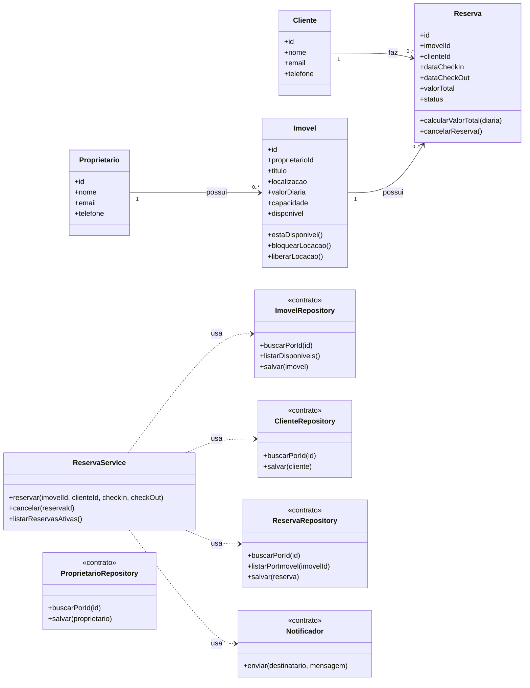

# Modelagem — Projeto 1

**Aluno(a):** Ingridy Abrantes de Matos
**Domínio:** Gestão de locação de sítios e imóveis de lazer

## 1. O domínio

A plataforma gerencia a locação de sítios e espaços de lazer para temporada. Um proprietário cadastra seus imóveis, e clientes realizam reservas desses espaços para datas específicas. Uma reserva só pode ser confirmada se o imóvel estiver com status disponível para locação.

## 2. Entidades

| Entidade | Atributos | Relacionamentos |
|---|---|---|
| Proprietário | id, nome, email, telefone | cadastra e possui vários imóveis |
| Imovel | id, proprietarioId, titulo, localizacao, valorDiaria, capacidade, disponivel | pertence a um proprietario e aparece em várias reservas |
| Cliente | id, nome, email, telefone | realiza várias reservas |
| Reserva | id, imovelId, clienteId, dataCheckIn, dataCheckOut, valorTotal, status | pertence a um imóvel e a um cliente |

## 3. Diagrama de classes



## 4. Responsabilidades

| Classe | Papel | Único motivo para mudar |
|---|---|---|
| Proprietario, Imovel, Cliente, Reserva | entidades | as regras do próprio objeto (ex.: cálculo do valor total da diária ou verificação de disponibilidade) |
| ReservaService | regra de negócio | o fluxo e processo de criar e cancelar reservas |
| ProprietarioRepository, ImovelRepository, ClienteRepository, ReservaRepository | acesso aos dados | a forma de persistir os dados (memória na S3, SQLite/PostgreSQL na S5) |
| Notificador | comunicação | o canal de confirmação ou aviso (e-mail, SMS, WhatsApp) |

## 5. Onde apliquei SRP e DIP

- **SRP:** nenhuma entidade salva a si mesma nem envia e-mails de confirmação. A persistência de dados é responsabilidade exclusiva dos repositories; os avisos e confirmações são papel do Notificador; a regra do processo de reserva fica concentrada no ReservaService.
- **DIP:** o ReservaService depende apenas das interfaces e contratos dos repositories e do Notificador, injetados via construtor. Ele não possui acoplamento com a forma como os dados são guardados (memória ou banco de dados relacional).

## 6. Fora do escopo (YAGNI)

Autenticação/Login com JWT, avaliações dos sítios, validação avançada de sobreposição/conflito de datas do calendário, cálculo de taxa de limpeza e pagamento online não entram no Projeto 1.
````